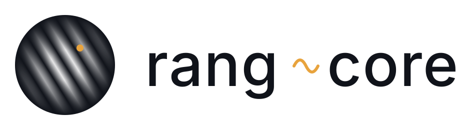

<p align="center"><picture><source media="(prefers-color-scheme: dark)" srcset="https://raw.githubusercontent.com/gijzelaerr/rang-core/main/docs/logo/lockup-on-dark.svg"></picture></p>

<p align="center"><b>MeerKAT calibration, flagging and imaging research on one Rust core, driven from Python.</b></p>

<p align="center"><a href="https://pythonic.nl/rang-core/">Documentation</a> · <a href="https://pythonic.nl/rang-core/tutorials/index.html">Tutorials</a> · <a href="https://github.com/gijzelaerr/rang-core/blob/main/research/README.md">Research index</a> · <a href="https://github.com/gijzelaerr/rang-core/blob/main/CHANGELOG.md">Changelog</a></p>

> **Status, November 2026: a tested research demonstrator, not an operational
> calibrator.** No novelty is claimed: the goal is better calibration and
> imaging at comparable cost, or comparable quality at much lower cost, and
> neither has been shown. The gain-TV flagging experiment is closed as null.
> The beam-and-pointing question is open: B1-2 found per-antenna pointing
> constrainable on real data, and B1-3 is running.

## What it is

- **A Rust core.** A Measurement Set reader and casacore table writer, zarr
  ingest with HTTP range fetch, QuartiCal's full-Jones solver, Tricolour's
  SumThreshold strategies, WSClean's imaging weights and w-stacking gridder (CPU
  and GPU), ducc0's wgridder, CASA's flux standards and a component predictor.
- **A Python package and command line.** `import rang` reaches every kernel
  through the extension `rang._core`, which releases the GIL. `rang-core STAGE VERB`
  replays, compares and archives each chain and writes a versioned receipt.
- **The tools' file formats.** CASA calibration tables, QuartiCal stores, Tigger,
  WSClean and BBS sky models, H5parm, killMS solutions, CASA flag versions and
  MeerKAT MVFv4 archives (`rang-core formats check` and `convert`).
- **Oracles.** Each port is gated on reproducing the upstream tool's output:
  QuartiCal, Tricolour, AOFlagger, WSClean, ducc0, casacore, CASA and katdal.

## Install

```sh
pip install rang-core
```

The first PyPI release, v0.1.0, is pending; until then, build from source. One
`abi3` wheel per platform serves CPython 3.10 and newer, needs no Rust compiler
and carries every kernel: Linux x86_64 and aarch64 (glibc 2.28 or newer), macOS
arm64 and x86_64, Windows x86_64.

| Extra | For |
| --- | --- |
| `notebook` | the tutorials and `rang.notebook` |
| `imaging` | FITS output of the gridders |
| `pointing`, `beam` | the JAX pointing path; the katbeam and EIDOS beam controls |
| `meerkat`, `formats` | MVFv4 archives through katdal; H5parm |
| `recipes`, `carta` | the Stimela2 recipes (Python 3.13); CARTA from the notebooks |
| `test`, `docs` | the test suite; the documentation site |

From source, with Rust 1.93 and `cargo` on `PATH` (more in the [installation guide](https://pythonic.nl/rang-core/installation.html)):

```sh
git clone https://github.com/gijzelaerr/rang-core && cd rang-core
python3 -m venv .venv
.venv/bin/python -m pip install -e '.[notebook,test]'
```

## Quick start

Load the public 45 MB MeerKAT fixture (four antennas on PKS 1934−638) and solve
its full-Jones gains on the Rust core. With `pip install 'rang-core[notebook]'`:

```python
from rang.notebook import data, gains

zip_path = data.download_fixture("rang-cache")   # once; SHA256 checked
ds = data.load_fixture(zip_path, cache_dir="rang-cache")
s = data.summary(ds)
print(s["dataset"], "|", s["antennas"], "|", s["channels"], "channels")
m = gains.solve(ds)["metrics"]
print(f"gain TV {m['tv']:.4f}  test MSE {m['losses']['test']:.3f}")
```

After the download it takes about two seconds and prints:

```text
fixture scan 9 (J1939-6342) | m000, m001, m002, m003 | 4096 channels
gain TV 0.1474  test MSE 24.920
```

The command line's main stages (`rang-core -h` lists them all):

| Stage | Chain |
| --- | --- |
| `flags` | Tricolour's SumThreshold strategies |
| `gridder`, `wgridder`, `weights`, `imaging` | gridders, imaging weights, the imaging replay |
| `campaign`, `campaign-array`, `campaign-1830`, `campaign-fieldmodel` | the LUNO real-data campaigns |
| `injections`, `actions`, `prospective`, `signal`, `trend` | the flagging experiment's tracks |
| `ms`, `meerkat`, `formats` | the readers and file formats |
| `check` | the full local checks, on any platform |

## Documentation

- [The site](https://pythonic.nl/rang-core/): installation, concepts, the command line and the research story.
- [Tutorials and science notebooks](https://pythonic.nl/rang-core/tutorials/index.html): five tutorials (data and rank, flagging, gains and TV, imaging, the flagging experiment) and two research notebooks (the flagging verdict; beam and pointing), executed on the fixture.
- [API reference](https://pythonic.nl/rang-core/api/index.html), generated from the docstrings.

## Research results

| Question | Verdict | Report |
| --- | --- | --- |
| Port the pipeline to one Rust core | Done: the archived chains reproduce, the solver to 1.4e-15; engineering, not a scientific claim | [architecture](https://github.com/gijzelaerr/rang-core/blob/main/research/p7-architecture.md), [simplification](https://github.com/gijzelaerr/rang-core/blob/main/research/simplification-review.md) |
| Does gain-TV-guided flagging help? | **Null**: 90 pre-registered calls, none better or worse, at 4.6–5.9× the cost of CARACal's first pass | [verdict](https://github.com/gijzelaerr/rang-core/blob/main/research/flagging-verdict.md) |
| Can beam and pointing be constrained on real data? | **Open**: per-antenna pointing (0.07′) and squint are, on ESO137; B1-3 is running | [B1-2](https://github.com/gijzelaerr/rang-core/blob/main/research/b1-2-identifiability.md), [B1](https://github.com/gijzelaerr/rang-core/blob/main/research/b1-beam-pointing.md) |
| What is proven about CLEAN? | Data-fit convergence since Schwarz (1978); here a Gram-matrix formalism, Lean proofs and the measured exact-recovery transition | [theory](https://github.com/gijzelaerr/rang-core/blob/main/research/clean-theory.md), [transition](https://github.com/gijzelaerr/rang-core/blob/main/research/clean-phase-transition.md) |
| An exact gridder | ducc0's wgridder ported at its speed; the w-stacking gridder on a GPU gains 1.2–3.3× over 16 threads | [wgridder](https://github.com/gijzelaerr/rang-core/blob/main/research/df1-wgridder.md), [GPU](https://github.com/gijzelaerr/rang-core/blob/main/research/x2-wgpu.md) |
| A casacore table writer | Byte-identical to casacore 3.8.1 and CASA 6.7.6, bar uninitialised memory and alignment gaps | [writer](https://github.com/gijzelaerr/rang-core/blob/main/research/e5-table-writer-rest.md), [the last of it](https://github.com/gijzelaerr/rang-core/blob/main/research/e6-table-writer-final.md) |
| Re-validation against upstream | Tricolour 0.5.0-dev flag-identical; QuartiCal's #452 fix reproduced to 1e-15; AOFlagger agrees at kernel level, differs at stage level; CASA `gaincal` is 75–350× slower | [RV1](https://github.com/gijzelaerr/rang-core/blob/main/research/rv1-revalidate.md), [AOFlagger](https://github.com/gijzelaerr/rang-core/blob/main/research/a-flag-aoflagger.md), [gaincal](https://github.com/gijzelaerr/rang-core/blob/main/research/l5c-casa-gaincal.md) |

Everything else, including the negative results and the earlier pointing pilots,
is in the [research index](https://github.com/gijzelaerr/rang-core/blob/main/research/README.md);
the latest progress is in [STATE](https://github.com/gijzelaerr/rang-core/blob/main/research/STATE.md).

## Repository guide

| Path | Contents |
| --- | --- |
| [`core/`](https://github.com/gijzelaerr/rang-core/tree/main/core), [`src/`](https://github.com/gijzelaerr/rang-core/tree/main/src) | the Rust core (`core/py` builds `rang._core`); the root crate with the pointing toy and gain TV |
| [`python/rang/`](https://github.com/gijzelaerr/rang-core/tree/main/python/rang) | the Python package, the command line and the JAX reference path |
| [`notebooks/`](https://github.com/gijzelaerr/rang-core/tree/main/notebooks), [`docs/`](https://github.com/gijzelaerr/rang-core/tree/main/docs) | the tutorials and science notebooks; the documentation site |
| [`examples/`](https://github.com/gijzelaerr/rang-core/tree/main/examples), [`tests/`](https://github.com/gijzelaerr/rang-core/tree/main/tests) | reproducible experiments and comparators; the test suite |
| [`recipes/`](https://github.com/gijzelaerr/rang-core/tree/main/recipes) | core-native Stimela2 recipes |
| [`research/`](https://github.com/gijzelaerr/rang-core/tree/main/research), [`formal/`](https://github.com/gijzelaerr/rang-core/tree/main/formal) | reports and compact result archives; Lean proofs |
| [`history/`](https://github.com/gijzelaerr/rang-core/tree/main/history), [`data/`](https://github.com/gijzelaerr/rang-core/tree/main/data) | the frozen campaigns; fixture provenance |

## Names

The project, repository, PyPI distribution and command line are **rang-core**; the
Python package is **`rang`** (`rangtoy` in notes written before the rename). "Rang"
began as Radio Astronomy Next Generation, and *rang* is Dutch for *rank*, the first
thing the identifiability survey measures.

## Contributing

[CONTRIBUTING.md](https://github.com/gijzelaerr/rang-core/blob/main/CONTRIBUTING.md) has the local checks, the release procedure and the reporting rules.

## Licence and data acknowledgements

rang-core is free software under the [GNU General Public License, version 3 or later](https://github.com/gijzelaerr/rang-core/blob/main/LICENSE).
Ported code keeps its upstream notices; no raw visibilities or beam maps are redistributed.

- **MeerKAT data.** The MeerKAT telescope is operated by the South African Radio
  Astronomy Observatory, which is a facility of the National Research Foundation,
  an agency of the Department of Science and Innovation.
- **L-band holography beams** (de Villiers 2023, DOI 10.48479/wdb0-h061): CC BY-NC 4.0.
- **ESO137 field** (Ramatsoku et al. 2020): CC BY 4.0.

Per upstream and dataset: [licence and acknowledgements](https://pythonic.nl/rang-core/licence.html).

## Citation

Cite the software through [CITATION.cff](https://github.com/gijzelaerr/rang-core/blob/main/CITATION.cff) (GitHub's "Cite this repository").
