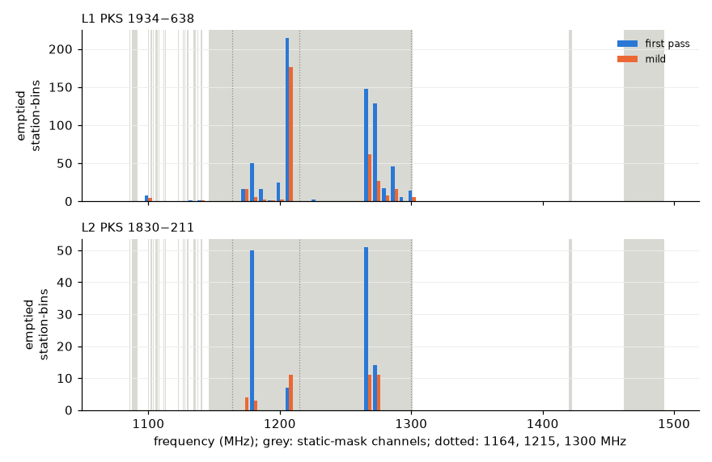
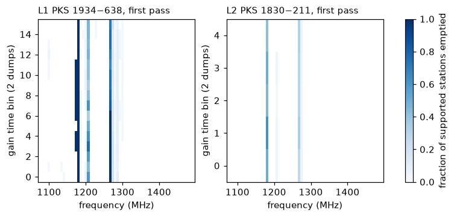

# A1: RFI-band audit of the station-bins the CARACal first pass empties

Task A1 of [big-plan.md](big-plan.md) (small, any time), from item 6 of
[literature-2024-2026.md](literature-2024-2026.md) ("A1 audit"). Branch
`a1-rfi-audit` from `5965d37`. Explanation only: no new flags, no change to
any campaign, no visibilities committed.

Status: **implemented and measured.** The protocol section was written
2026-10-30 before any audit code ran; the results follow it. Every
reproduction gate passes on both calibrators. Archive:
[results/a1-rfi-audit.json](results/a1-rfi-audit.json); run
`outputs/a1-rfi-audit-20261030-01/{l1,l2}`.

**Conclusion in one paragraph.** Every emptied station-bin lies in a block
that the Tricolour static mask touches. 682 of 691 (L1) and all 122 (L2) lie
in blocks of the 1145.8–1301.0 MHz GNSS range, on the GNSS carriers: L5/E5a 1176 MHz, E5b/B2
1207 MHz, BeiDou B3 1268 MHz and Galileo E6 1279 MHz. None lies in
1304–1498 MHz, which holds the protected 1400–1427 MHz band. The input FLAG
had already removed 99.6–99.8 % of these bins' cells, so what the first pass
cuts is a residue of 1–57 training samples (median 5) per station-bin, on
long baselines. Four observations together make this RFI excision in a known,
persistent RFI band, working as the strategy intends:

- the bins coincide with the GNSS carriers;
- they persist over every dump of both scans;
- mild, which has no static mask, and a mask-free first pass empty the same
  blocks;
- the strategy flags 99 % of the held-out cells in the same bins too.

Polarised intensity is only supporting evidence: the removed cells sit above
the kept ones, but a flagger selects the upper tail by construction.

The result supports U2's decision not to file. No apparently clean band is
removed, so there is no report of removed clean data. One question about the
strategy's step semantics is left for the coordinator (see the conclusion).

## Question

L1 (PKS 1934−638, [luno-array-campaign.md](luno-array-campaign.md)) and L2
(PKS 1830−211, [luno-1830-campaign.md](luno-1830-campaign.md)) found that the
CARACal first-pass Tricolour strategy removes every training sample of some
station × gain-bin cells, so the solver flags those gains and held-out samples
there cannot be predicted. U2 ([upstream-prs.md](upstream-prs.md) §6) saw the
same on the fixture scan 9 and judged it whole-channel RFI excision. A1 asks,
on the two whole-array LUNO runs: in which frequency blocks, dumps, stations
and baselines do these bins fall; do they coincide with known L-band
allocations or the Tricolour static mask; which strategy step removed the
data; and is anything apparently clean being removed?

## Protocol (written before the audit ran)

**Inputs (read-only).**

- L1: `outputs/luno-array-campaign-20261030-01` (`flags/<arm>.npz` additions,
  `gains/<arm>.npz` `gain_valid`, `result.json`), inputs as L1 resolved them.
- L2: `outputs/l2-1830-20261030-02-stored` and `-02-scalar`, DATA and UVW
  from `outputs/l2-1830-20261030-01-fetch`. The two model arms share the
  split (four `split.sha256` equal) and the Tricolour additions
  (`5e697f5c…`), so the emptied set is one set; their *lost* sets may differ
  through the solver.
- Strategies `outputs/caracal-strategy-inputs-8f7bb363`
  (first pass `mk_rfi_flagging_calibrator_fields_firstpass.yaml`, mild
  `calibrator_mild_flagging.yaml`), static masks `core/data/`.

**Definitions.** Gain bins are the campaigns' frozen grid: 2 dumps × 32
channels, so 64 frequency blocks of 32 channels over 1070.0–1497.8 MHz.
A *station-bin* is (time bin, block, station).

- *Training support* of a station-bin: training cells (seed-7 split) on rows
  with that station as ANTENNA1 or ANTENNA2.
- *Emptied* by an arm: support > 0 in `original` and support of
  `train & ~additions` = 0. Station-bins with no support in `original` (the
  input FLAG already emptied them, including m031, m040 and m044) are
  counted separately and are not "emptied".
- *Lost*: `gain_valid(original) & ~gain_valid(arm)` from the archived gains.
  Emptied and lost are reported separately with their intersection; a lost
  bin that is not emptied is a solver effect, not a flagging one.

**Reproduction gates.** The audit decodes the inputs with the campaigns' own
functions (`decode_inputs`, `build_state` with seed 7) and reruns the
Tricolour port (`core_flag.flag_rows`, per-step stages kept). It proceeds only
if: the split counts equal the archived ones (and, for L2, the four split
SHA256 values); the rerun's `window & train` equals the archived additions of
both arms cell for cell; and held-out cells with an invalid station gain under
the archived `gain_valid` reproduce the archived invalid-prediction counts
(L1 680/678 first pass, 120/111 mild; L2 85/63 stored and 94/67 scalar first
pass, 28/18 mild).

**Counted, per campaign and arm (first pass and mild).**

1. Emptied station-bins, and the (time bin, block) cells they occupy with the
   number of stations emptied in each ("array-wide" if every station with
   support there is emptied).
2. By frequency: block → MHz range, overlap with the allocation bands below
   and with the static-mask channels.
3. By time: time bin and dump (UTC from TIME).
4. By station (names), and the removed training cells of emptied bins by
   physical baseline length (ECEF, bands 0–200, 200–1000, 1000–3000,
   3000–9000 m).
5. Step attribution of every removed training cell: the earliest step from
   which the window flag stays set through the last flagging step (the
   strategy's `uvcontsub_flagger` steps *replace* the running flags, so a
   cell's first flag can be discarded later). Grouped as static mask,
   SumThreshold, uvcontsub, NaN/zero.
6. Static mask against SumThreshold, by counterfactual strategies run on the
   same inputs: static mask only (steps `flag_nans_zeros`, the all-baseline
   `apply_static_mask`, `combine_with_input_flags`); the same with the
   strategy's surviving `uvrange 0~550` mask; and the first pass without its
   two `apply_static_mask` steps. A bin is "static alone" if a static-only
   strategy empties it, "SumThreshold alone" if the mask-free first pass
   empties it, "both" if both do, "only together" otherwise. These
   counterfactuals are not additive (the mask shapes the SumThreshold
   background) and are labelled as such. Mild has no static-mask step at all
   and is the natural mask-free control.
7. The input-unflagged cells of emptied bins (training and held out): the
   fraction the final window flags (100 % of the training cells by
   construction; the held-out ones tell whether Tricolour would have flagged
   them too), and whether the removed cells lie on (dump, channel) columns
   the strategy flags on every baseline (whole channel/dump excision).
8. A data statistic, so that "coincides with a band" is not the only
   evidence: the polarised intensity √(|Q|²+|U|²+|V|²) that Tricolour flags
   on (both calibrators are unpolarised), as a robust z per baseline and
   128-channel tile against the cells the first pass keeps. Reported as
   quantiles and counts for removed cells in emptied bins, removed cells
   elsewhere and kept cells; per emptied bin its maximum z. A bin whose
   removed cells contain no |z| > 5 is "no outlier of its own" (removed by
   time/frequency extension or the fraction rules).
9. Same bins on both calibrators: overlap of the emptied (block, station)
   sets of L1 and L2 (different scans and times, so not by time).

**What counts as "coincides with a known band".** A block coincides if any
of its 32 channel intervals overlaps the band. Reference allocations (ITU
Region 1, approximate edges; in-window unless stated):

| Band | MHz | In 1070–1497.8? |
| --- | --- | --- |
| GSM/LTE downlinks | below 960 | outside the window |
| DME/TACAN, ADS-B/SSR (1030, 1090) | 960–1215 | 1070–1215 |
| GNSS L5/E5a/E5b/B2, GLONASS G3 | 1164–1215 | yes |
| GNSS L2/G2, Galileo E6, BeiDou B3 | 1215–1300 | yes |
| Aeronautical radionavigation / primary radar | 1300–1350 | yes |
| Fixed, mobile, radiolocation | 1350–1400 | yes |
| Radio astronomy (passive, protected) | 1400–1427 | yes |
| Mobile (IMT L-band) / BSS-DAB 1452–1492 | 1427–1518 | 1427–1497.8 |
| Inmarsat / MSS downlink | 1525–1559 | outside |
| GPS L1, Galileo E1, GLONASS G1 | 1559–1610 | outside |
| Iridium; Inmarsat uplink | 1616–1626.5; 1626.5–1660.5 | outside |

and, separately, the static-mask ranges derived by applying the shipped
masks to the actual channel grid with the port's rule (a mask frequency in
[ν − Δν/2, ν + Δν/2)).

**Satellite passes.** No ephemeris check: neither `skyfield` nor `sgp4` nor
any TLE set is available offline on this host, and nothing is installed for
this audit. The allocation table stands in for it. Recorded as not done.

**Outputs.** `outputs/a1-rfi-audit-20261030-NN/<campaign>/` (per-bin arrays
and a JSON summary; no visibilities), `research/results/a1-rfi-audit.json`
(counts, tables, quantiles), at most two small figures
`research/figures/a1-*.png`. Code: `examples/audit_emptied_bins.py`.

## Results (measured 2026-10-30)

Run `outputs/a1-rfi-audit-20261030-01/{l1,l2}` (code as committed here);
`summarise` wrote the archive and the two figures. All numbers below are in
the archive unless marked as the scratch probe.

### Reproduction gates: all pass

| Gate | L1 (1934−638) | L2 (1830−211) |
| --- | --- | --- |
| split counts (and SHA256 for L2) equal the archive | yes | yes (all four hashes) |
| rerun `window & train` equals the archived additions, first pass and mild | yes, cell for cell | yes, for both model arms |
| invalid held-out predictions from the archived `gain_valid` | first pass 680/678, mild 120/111: equal | stored 85/63, scalar 94/67, mild 28/18 (both arms): equal |
| emptied = lost (archived gains) | first pass 691 = 691; mild 325 = 325 | stored 122 = 122; scalar 123 lost, 122 of them emptied, **1 lost bin not emptied** (a solver effect); mild 40 = 40 |

Consequences of the gates:

- The emptied station-bins are exactly the campaigns' unpredictable bins.
- No emptied bin had an invalid `original` gain.
- The flags are identical to L1's. The first pass took 48 s here against 763
  s in L1's frozen run. The difference was not investigated; L1 ran under
  heavy contention (load average 28, 0.62 cores busy).

### Where the emptied station-bins are

Station-bins:

- L1 has 16 time bins × 64 blocks × 56 stations = 57,344. 8,352 of them
  already had no training support from the input FLAG, including every bin
  of m031, m040 and m044.
- L2 has 5 × 64 × 56 = 17,920, of which 1,553 had none.

**By frequency.** The table gives emptied station-bins for the first pass,
with mild in brackets. Blocks with the same signal are summed; the carrier
frequencies are the public GNSS signal plans.

| Blocks (MHz) | What is there | L1 | L2 |
| --- | --- | ---: | ---: |
| 4, 9, 10 (1096.7–1103.3, 1130.1–1143.5) | DME band; the static mask's narrow ranges cover 25–31 % of the block | 9 (5) | 0 (0) |
| 15–17 (1170.2–1190.3) | GPS L5 / Galileo E5a, carrier 1176.45 | 82 (23) | 50 (7) |
| 18–19 (1190.3–1203.7) | GLONASS G3, 1202.0 | 26 (3) | 0 (0) |
| 20 (1203.7–1210.3) | Galileo E5b / BeiDou B2I, carrier 1207.14 | **214 (176)** | 7 (11) |
| 23 (1223.7–1230.4) | GPS L2, 1227.6 | 2 (0) | 0 (0) |
| 29 (1263.8–1270.5) | BeiDou B3I, 1268.52 | **148 (62)** | 51 (11) |
| 30–33 (1270.5–1297.3) | Galileo E6, 1278.75 | 196 (51) | 14 (11) |
| 34 (1297.3–1304.0, 56 % masked) | GNSS / radar edge | 14 (5) | 0 (0) |
| 35–63 (1304.0–1497.8) | radar, fixed/mobile, **RA 1400–1427**, IMT/DAB 1427–1518 | **0 (0)** | **0 (0)** |
| total | | 691 (325) | 122 (40) |

The same counts by allocation band follow. A block counts in every band it
overlaps, so DME and GNSS L5 share blocks.

| Band (MHz) | L1 first pass | L1 mild | L2 first pass | L2 mild |
| --- | ---: | ---: | ---: | ---: |
| GSM/LTE < 960 | outside the window | | | |
| DME/SSR/ADS-B 960–1215 | 331 | 207 | 57 | 18 |
| GNSS L5/E5/B2/G3 1164–1215 | 322 | 202 | 57 | 18 |
| GNSS L2/G2/E6/B3 1215–1300 | 360 | 118 | 65 | 22 |
| radar 1300–1350 | 14 (block 34 only) | 5 | 0 | 0 |
| 1350–1400, 1400–1427, 1427–1518 | 0 | 0 | 0 | 0 |
| Inmarsat 1525–1559, GPS L1 1559–1610, Iridium 1616–1626.5 | outside the window | | | |

The static-mask ranges inside the training window were derived from the
shipped masks with the port's rule (987 of 2,048 channels):

- 20 narrow ranges in 1085.6–1141.2 MHz;
- 1145.8–1301.0 MHz;
- 1420.2–1422.5 MHz;
- 1462.0–1492.5 MHz.

The figure shows the counts per block. Grey marks the static-mask channels;
the dotted lines are at 1164, 1215 and 1300 MHz.

**By time.** The bins are spread over every time bin, with no transient:

- L1 first pass: 30–57 per time bin (13:44:07–13:48:15 UTC, 2021-08-18,
  32 dumps);
- L2 first pass: 22–29 per time bin (13:54:38–13:55:50 UTC, 10 dumps).

That fits continuously transmitting GNSS carriers, not a satellite or
aircraft pass. The next figure gives, per (time bin, block), the fraction of
supported stations emptied.

**By station.** The bins are not clustered on a few stations.

- L1: 53 stations have at least one emptied bin. The most affected are outer
  stations, with m063 at 48, m059 at 33, and m038 and m051 at 30 each.
- L2: 28 stations, at most 10 each (m036).

Comparing the two calibrators:

- **Frequency is shared.** All four of L2's first-pass blocks (16, 20, 29,
  30) are among L1's 16 blocks.
- **Stations are not.** The (block, station) sets overlap little: 11 pairs
  are common out of 133 (L1) and 35 (L2), Jaccard 0.07. The loss follows the
  frequency, not particular antennas.

How much of each (time bin, block) cell is emptied:

- L1: of the 155 cells with an emptied bin, a median of 3 stations is
  emptied, out of a median of 46 with support. 111 emptied bins (16 %) lie in
  cells where *every* supported station is emptied. These are mostly block
  16 (1176.9–1183.6 MHz), where the input FLAG covers 99.97 %.
- L2: no cell is array-wide.

**By baseline length.** The table gives the removed training cells inside
emptied bins, counted per cell.

| Physical length | L1 first pass | L2 first pass |
| --- | ---: | ---: |
| 0–200 m | 0 | 0 |
| 200–1000 m | 35 | 0 |
| 1–3 km | 985 | 47 |
| 3–9 km | 4,928 | 640 |

The emptied bins are a long-baseline residue. A labelled scratch probe
(session scratchpad, numbers only; not in the archive) measured how much of
the static-mask channels the input FLAG already covers:

| Physical length | L1 | L2 |
| --- | ---: | ---: |
| below 500 m | 100 % | 100 % |
| 0.5–1 km | 94 % | 89 % |
| 1–2 km | 75 % | 62 % |
| 2–3 km | 73 % | 50 % |
| above 3 km | 64 % | 41 % |

The upstream flagging was therefore length-dependent. On the GNSS carrier
blocks themselves the input FLAG covers 97–100 %.

**What the input FLAG covered.** In the emptied station-bins:

- 99.6 % (L1) and 99.8 % (L2) of the cells were already input-flagged,
  against 55.8 % and 41.5 % over all supported station-bins;
- an emptied station-bin held 1–57 training cells before the first pass in
  L1 (median 5), and 1–28 in L2 (median 5).

### Which step removed the data

The first pass's `uvcontsub_flagger` steps replace the running flags. In L1
the window fraction falls from 0.741 after step 02 to 0.251 after step 03,
below the input's 0.621; the input is restored by the final
`combine_with_input_flags`.

- The all-baseline static mask of step 01 therefore survives only where step
  03's output keeps it.
- The `uvrange 0~550` mask of step 05 adds *nothing* new on either
  calibrator: run alone it flags no input-unflagged cell, because the input
  FLAG already covers the static channels on the baselines it selects.

For each removed training cell in an emptied bin, the step credited is the
earliest step from which its flag stays set. The counts are station-bin
incidences: a cell counts on both of its stations if both are emptied.

| | L1 first pass | L2 first pass | L1 mild | L2 mild |
| --- | ---: | ---: | ---: | ---: |
| static mask (step 01) | 902 (13 %) | 76 (11 %) | – (no mask step) | – |
| SumThreshold | 5,908 (87 %; 5,561 from the very-broad step 06) | 634 (89 %) | 1,286 (97 %) | 226 (99 %) |
| uvcontsub | 3 | 2 | 40 | 3 |
| bins whose removed cells come from SumThreshold only / static mask + SumThreshold / static mask only | 325 / 262 / 104 | 85 / 37 / 0 | – | – |

Counterfactual strategies were run on the same inputs. They are not additive,
because the mask shapes the SumThreshold background.

| | L1 | L2 |
| --- | ---: | ---: |
| emptied by the first pass | 691 | 122 |
| of these, emptied both by the static mask alone and by the mask-free first pass alone | 595 | 102 |
| by the static mask alone only | 77 | 20 |
| by the mask-free first pass alone only | 18 | 0 |
| only by the two together | 1 | 0 |
| emptied by the mask-free first pass (all) | 704 (91 not emptied by the real first pass) | 140 |
| emptied by the all-baseline static mask alone | 18,611 | 6,297 |
| emptied by the `0~550` static mask alone | 0 | 0 |

Three readings follow:

- The mask-free strategies empty the same GNSS blocks: mild (no mask step at
  all) and the first pass without its mask steps. The loss is data-driven,
  not an artefact of the mask.
- The static mask alone would empty them as well.
- If the step-01 mask survived on every baseline, as its name
  (`background_static_mask`) suggests, it would empty 18,611 station-bins:
  the whole GNSS band.

### Was clean data removed?

**Held-out cells in the same bins.** The strategy's window flags them too:

- L1: 1,542 of 1,553 (99.3 %);
- L2: 149 of 151.

The first pass would have flagged essentially every input-unflagged sample of
these bins; the split only decided which of them were training cells.

**Whole channels or dumps.** The removed cells are mostly *not* whole-column
cuts:

- L1: 24 % (1,426 of 5,948) lie on (dump, channel) columns where the strategy
  flags every input-unflagged cell, and 59 % on columns where it flags at
  least half;
- L2: 2.5 % and 46 %.

This differs from U2's scan-9 picture of whole channels and dumps. Here the
input FLAG had already removed nearly everything, and SumThreshold removes
the long-baseline residue.

**Polarised intensity.** The statistic is the robust z of
√(|Q|²+|U|²+|V|²) per baseline and 128-channel tile, against the cells the
first pass keeps.

| Cells | L1 median z | L1 90 % | L1 above 5 | L2 median z | L2 90 % | L2 above 5 |
| --- | ---: | ---: | ---: | ---: | ---: | ---: |
| removed, in emptied bins (first pass) | 1.71 | 6.02 | 14.9 % | 1.75 | 3.76 | 0.6 % |
| removed, elsewhere (first pass) | 0.52 | 2.95 | 2.3 % | 0.76 | 2.96 | 0.6 % |
| kept training | 0.00 | 1.36 | 0.005 % | 0.00 | 1.37 | 0.004 % |
| removed, in emptied bins (mild) | 3.71 | 8.42 | 35 % | 1.63 | 2.86 | 0 % |

Per emptied bin:

- L1: 345 of 691 contain a removed cell with z > 5. The median of the
  per-bin maximum z is 5.0 (10–90 %: 1.6–12.0).
- L2: 4 of 122 contain such a cell; the median maximum z is 2.3.

The removed cells are shifted above the kept distribution, but individually
they are mostly moderate. That is consistent with what SumThreshold is built
to catch: a faint, persistent excess that is significant over a window but not
per sample, which a GNSS carrier on a long baseline would be, since fringe
rotation and averaging decorrelate it.

The statistic carries limited weight. The verdict rests on the band
coincidence, the persistence, the mask-free strategies and the held-out
flags; the z only supports it. Four limits apply to the z:

- A flagger removes the upper tail by construction, so part of the shift is
  selection, not RFI.
- On L2 the evidence is weak: 118 of 122 emptied bins have no outlier of
  their own, and the fraction above 5 (0.6 %) equals that of removed cells
  elsewhere.

- 5,782 of 22,048 (L1) and 6,251 of 24,640 (L2) baseline × tile groups had
  fewer than 20 kept cells, mostly in the GNSS range. They used the
  all-baseline tile as reference, which mixes baseline noise levels.
- PKS 1934−638 is unpolarised. PKS 1830−211 is not assumed to be: a smooth
  polarised component only shifts the per-tile median, which the z removes.
  The protocol's "both unpolarised" was too strong.

**Satellite passes.** Not checked against ephemerides (no `skyfield`, `sgp4`
or TLE set offline). Two observations make a transient pass unlikely as the
explanation:

- the bins persist over all dumps of both scans, which are 10 min apart;
- they coincide with the carrier frequencies of four GNSS constellations.

## Conclusion

1. **Excision as intended.**
   - The emptied station-bins are the long-baseline residue of the GNSS band
     (1164–1300 MHz carriers) after the input FLAG, plus 9 bins in DME-band
     static-mask blocks.
   - The first pass's SumThreshold steps remove that residue, and its static
     mask would remove it too. Mild and the mask-free first pass empty the
     same blocks.
   - The strategy flags the held-out cells of the same bins as well, and the
     bins persist over every dump of both scans.
   - Nothing in 1304–1498 MHz is emptied on either calibrator.
   - Polarised intensity is consistent with this but carries a selection
     caveat; it is supporting evidence only.

   This supports U2's decision not to file, and there is **no reproduction
   of removed clean data for a CARACal/Tricolour report**.

   One *question*, not a bug claim, is recorded for the coordinator. The
   first pass's step-01 all-baseline mask (`background_static_mask`) is
   discarded by the replacing `uvcontsub_flagger` of step 03
   (`residual_flag_initial`).
   - This follows the executor's replace semantics. It is not a port
     artefact: task D verified every per-step stage exactly against the
     Tricolour 0.2.1 oracle (criterion 3).
   - Its size: applied on every baseline, the mask alone would add 5.35 M
     training cells (L1) and empty 18,611 station-bins. The executed first
     pass adds 0.61 M cells and empties 691.
   - The surviving step-05 `0~550` mask adds nothing on these pre-flagged
     data.

   Was the step-01 mask meant to be dropped by `residual_flag_initial`?
2. **What the campaigns should do (proposal, not a change).**
   - **Primary proposal.** For future campaigns (L4, L1-M, C1), pre-register
     dropping the emptied station-bins' held-out samples from every arm's
     validation and test sets, and state the dropped count.
     - The split is seed-fixed, and the Tricolour window depends only on
       DATA and the input FLAG, not on any solve. So the emptied set can be
       computed **after the split and before any solve**, then frozen.
     - It cannot be computed before the split. "Emptied" is defined on
       training support. The rule that can run before the split ("the window
       flags every eligible cell of the station-bin") catches only 681 of
       L1's 691 first-pass bins and 121 of L2's 122, missing 23 and 3
       held-out samples.
     - On L1 the drop is 1,358 of 6.84 M held-out samples (0.02 %); on L2,
       148 of 3.37 M (0.004 %).
     - It leaves the shipped CARACal strategy, the state-of-the-art
       comparator, unchanged.
     - Keep amendment 1's matched-sample rule as the fallback. The L2 scalar
       arm has one lost bin that is not emptied, a solver effect that no
       flag-defined rule removes. That is why its counts are 94/67 and not
       85/63.
   - **Secondary option.** A strategy variant that keeps a minimum training
     support per station-bin. It is admissible only as an *extra* arm, never
     as the comparator: it would keep GNSS-band samples that the shipped
     strategy and the input flags deliberately remove. The gains those 1–57
     samples would identify are not useful for science.
   - **Reject.** Treating these bins as evidence against Tricolour.
3. **For the gain-TV research.** The bins are a frequency property of the
   GNSS band, not a station or gain property. A TV-guided method should not
   be credited for keeping them.

## Timings (every tool run of this task)

Host: WSL2, 16 CPUs, 30 GiB, shared with sibling sessions; load average 5–8
during the runs.

| When (UTC) | Tool run | Wall | Peak RSS | Note |
| --- | --- | ---: | ---: | --- |
| 2026-10-30 | `uv venv` + `uv pip install -e '.[pointing,beam,test,imaging]' ruff maturin` (public PyPI) | 38.3 s | – | |
| 2026-10-30 | `maturin develop --release --offline` | 0.3 s | – | build cache warm |
| 12:36 | `audit_emptied_bins.py run l2` under `/usr/bin/time -v` (MemAvailable 14 GiB) | 3 min 12 s | 3.38 GB | decode + split 14.9 s; Tricolour first pass 23.6 s, mild 18.2 s, mask-free 24.3 s, static-only 2.0 + 1.9 s; polarised z 99.4 s |
| 12:42 | `audit_emptied_bins.py run l1` (MemAvailable 25 GiB) | 5 min 24 s | 10.05 GB | decode + split 21.9 s; first pass 48.0 s (L1's frozen run: 763 s), mild 32.5 s, mask-free 45.1 s, static-only 5.6 + 5.5 s; polarised z 153.2 s |
| 2026-10-30 | `summarise` (L2 only, then both, without figures) | 0.2 s | – | the first call with figures failed: matplotlib missing |
| 2026-10-30 | `uv pip install -e '.[…,plot]'` (matplotlib, public PyPI) | 30.3 s | – | |
| 2026-10-30 | `summarise` with archive and figures | 2.1 s | – | |
| 2026-10-30 | scratch probe: input-FLAG coverage of the static channels by baseline length (both calibrators, labelled) | 5.8–7.4 s | 7.3 GB | numbers only; one earlier attempt failed on a syntax error |
| 2026-10-30 | scratch probe: the rule that can run before the split against the emptied set, from `bins.npz` | about 1 s | – | numbers only |
| 2026-10-30 | `ruff check --fix` / `ruff format` on the script | < 1 s | – | |
| 2026-10-30 | `flock ~/.rang-checkall.lock bash tools/check-all.sh` (first attempt) | killed after about 20 min | – | **deadlocked**: since `a279d34` the script takes the same lock itself, so the outer `flock` blocked the inner one; the coordinator's correction says to run it plainly |
| 2026-10-30 | `bash tools/check-all.sh`, run plainly, once before the commit (`outputs/a1-rfi-audit-20261030-01/check-all.log`) | 4 min 15 s (pytest 631 passed, 3 skipped in 2 min 41 s) | 1.66 GB | overall **PASS** |

## For the coordinator

- **STATE paragraph.** "Big plan task A1 (RFI-band audit), 2026-10-30
  (implemented; measured; explanation only). Reran the Tricolour port with
  per-step stages on L1 and L2, reproducing the archived additions, splits
  and invalid-prediction counts exactly.
  - The station-bins the CARACal first pass empties are exactly the
    campaigns' lost gain bins: 691 on 1934−638 and 122 on 1830−211.
  - All of them are in static-mask blocks, 682/691 and 122/122 on the GNSS
    carriers (1176, 1207, 1268, 1279 MHz). None is in 1304–1498 MHz.
  - They are the long-baseline residue (median 5 training samples, 99.6 %
    already input-flagged) that SumThreshold removes. Mild and a mask-free
    first pass empty the same blocks, they persist over all dumps, and the
    strategy also flags 99 % of the held-out cells there.

  RFI excision as intended; supports U2's not filing; no report of removed
  clean data. Proposal: pre-register dropping the emptied bins' held-out
  samples, computed after the split and before any solve (0.02 % of
  held-out samples), with the matched-sample rule as the fallback. Report:
  `research/a1-rfi-audit.md`."
- **Plan line** (`big-plan.md`): "A1 RFI-band audit: done 2026-10-30, branch
  `a1-rfi-audit`. GNSS-band residue, excision as intended, no report.
  Proposal for L4/L1-M/C1: drop the emptied bins' held-out samples,
  computed after the split and before any solve, with the matched-sample
  rule as fallback. One question for RATT: the step-01 static-mask
  discard."
- **Upstream candidates.** Nothing filed. One candidate *question*, to be
  sent only after the user's say:
  - RATT (`caracal-pipeline/caracal`, with `ratt-ru/tricolour` for the
    executor). In the first-pass strategy, `residual_flag_initial`
    (`uvcontsub_flagger`, replace semantics) discards the all-baseline
    `background_static_mask`. Was that intended?
    - Measured on L1: the mask alone would add 5.35 M training cells and
      empty 18,611 station-bins; the executed strategy adds 0.61 M and
      empties 691.
    - The behaviour is verified as Tricolour 0.2.1's, stage by stage (task
      D criterion 3).
    - It is a question, not a bug report.
  - Non-RATT: none (no SARAO, katdal or allocation question arises).
- **Timing rows** for `tool-timings.md`: the table above.
- **Open items.**
  - The ephemeris check was not done: no offline TLE set or `sgp4`.
  - The polarised-z reference falls back to the all-baseline tile in about a
    quarter of the baseline × tile groups.
  - The length-coverage numbers, and the count for the rule that can run
    before the split (681/691, 121/122), come from scratch probes on the run
    outputs. They could be folded into `audit_emptied_bins.py` if they are
    needed again.
  - The step-01 static-mask discard question above.
