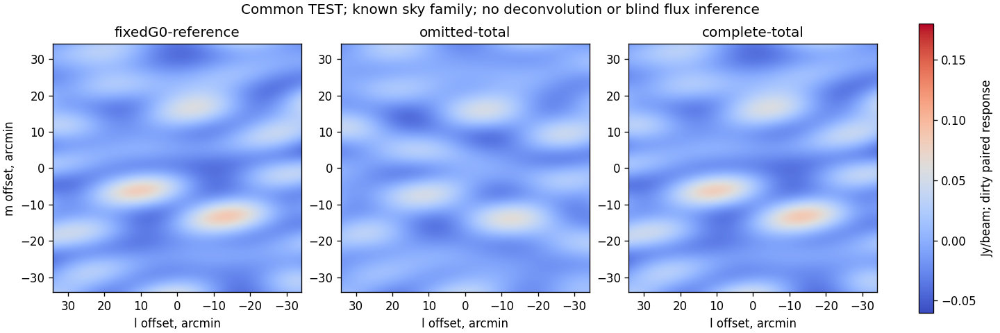

# MeerKAT L-band: five-track measured prototype

2026-09-24. All five requested tracks now have measured outcomes. The original
parallel graph completes four branches and fails imaging before any FITS;
the separately fresh 02 imaging retry executes all 15 inversions but fails its
independent semantic audit on duplicated template spectra. The precise fix and
separately fresh 03 imaging-only retry succeed. No original master
gather/result is invented. This is a reproducible prototype result, not a
validated telescope flagger or state-of-the-art claim.

Paths (2026-10-30, task P8): the frozen `tv-flagging*` recipes,
`tools/flagging/` and the recipe-only modules named here now live under
[`history/`](../history/README.md); this text keeps the paths it was written
with.

Scientific source for the original branches is `ec2f17d`; corrected imaging
retry source is `e3cab8c`. All 63 new QuartiCal invocations use native weights,
full complex 2×2 gains, 2-integration × 32-channel intervals and 50 iterations. The
30 completed WSClean inversions reuse saved gains, without additional QC:
15 retained 02 invalid-basis inversions and 15 corrected 03 inversions of the
same 15 frozen physical jobs, not 30 independent controls.
Received Observatory FLAG/FLAG_ROW, source DATA/model/native weight and sigma
columns remain authoritative; all mutations are on exclusive backed-up copies.

## Three useful results

1. **Estimated trend removal fixes this specificity control.** Across seven
   saved baseline solutions and four legitimate unaliased scalar-phase patterns,
   the 21 added-pattern comparisons change raw-TV top-six order 17 times but
   detrended order zero times. Clean raw TV rises 1.88 times, while detrended TV
   remains 0.147217810102436 to floating-point precision. Slopes come only from
   TRAIN-supported full-Jones gains, not supplied injected phases. This is a
   saved-gain guidance result, not arbitrary beam/Jones or finite-iteration QC
   invariance. [28 replays and verification](flagging-next-trend-verification.md).
2. **Prospective physical forecasts match the measured shortlist reference.**
   All 51 masks are frozen and forecast before any new candidate outcome. Physics
   matches the reference-best choice in all 3 cases: no-change for clean/seed107;
   one 56-cell mask for seed109. Predicted benefit 0.000419943 versus measured
   0.000427073, with zero missed benefit inside this union. Known injected-patch
   recall is 9.40%, with zero additions outside that artificial patch. Forecast
   RMSE is 4.5–8.6 times lower than negative-flag-cost-only descriptive control.
   Residual/raw-TV/detrended rankings share this winner: no trend-ranking win.
   We actually spend 54 QC calls to establish the reference; 3 baselines + 1 future
   confirmation is an accounting counterfactual, not measured native speedup.
   [Prospective verification](flagging-next-prospective-verification.md).
3. **Dirty images confirm strong incomplete-sky absorption.** Corrected 03 uses
   the intended −0.5/−0.9 spectra exactly once; its fixed-G0 reference fits
   59.999996/119.999990 mJy, with pixel-MSE proxy 3.46e-17. Same native weights,
   all 9,169 TEST cells and matched PSFs give compact/extended response 49.17%/77.57%
   for omitted sky versus 99.69%/98.65% for truth-complete diagnostic sky.
   Direct correction preserves both perturbations; gain adaptation removes
   about 51.03%/22.42% of fixed-G0 response when sky is omitted. Image
   total=direct+adaptation closes within 3.81e-8 Jy/beam, below the premeasurement
   1e-6 limit. These are conditional paired known-template dirty fits, not blind
   source fluxes, deconvolved fidelity or confidence intervals.
   [Corrected image receipt](results/gain-tv-next-imaging.json).



The broad fitted PSF is about 14.94×4.82 arcmin: only four antennas and 112 seconds
from the original real MeerKAT pointing scan. Full DATA images are dominated by
real sky and sidelobes; the plot shows paired differences, not cleaned science
images. WSClean also emits `-image.fits` at niter0; analysis uses dirty/PSF FITS
only and does not claim a CLEAN-component reconstruction.

## Safety and verification findings matter as much

The TRAIN-only absolute signal guard **abstains**, rather than certifying the
56-cell winner. Its first probe reaches a bin with just two TRAIN cells on
one 0–2 baseline: normal rank 8 versus required 12 for two active stations after
the assumed common U2 gauge. No transfer matrix or numeric near-identity error
is available; this is not rejection by a measured ||T−I|| threshold. Nochange
is explicitly UNCERTIFIED. Nine paired solves retain all 9,169 TEST cells; the
56-cell mask changes omitted-source recovery by only about 0.012/0.016 percentage
points. Sky completeness dominates. [Guard audit](flagging-next-signal-verification.md).

The separately frozen read-only [rank survey](flagging-next-gain-support.md)
quantifies this rather than implying a broad rank failure: each case has
287 identified/288 TRAIN-supported bins, covering 73,718/73,720 TRAIN cells
(99.997287%). 608 grid bins have no TRAIN data and are counted separately. The
two-cell connected-but-bipartite bin811 is the only rank failure. All 1,751
survey checks pass, with no new QC or data changes. We do not retrospectively
drop those cells or relax the gauge condition. Removing a rank obstacle would
still not establish an absolute signal-safe transfer; sky absorption is a
different gate.

The bounded public-data recovery obtains 85 chunks/505 strings/21 HISTORY rows.
Those rows record one CASA split with datacolumn=all and keepflags=True, not
the preceding weight/calibration history. Native DATA/noise convention remains
unverified, so MS conversion and native-sigma QC gates stay false. No MAIN
visibility requests or publisher unpickling occur.
[Provenance audit](flagging-next-provenance-verification.md).

Existing full CARACAL-strategy diagnostics remain useful checks. Mild operational
flags retain the same9169TESTsupport/PSF but slightly increase fixed-region dirty
RMS,3.279025→3.279980Jy/beam. Rejected firstpass loses1357TESTcells (7812remain),
changes PSF by0.07470 in max norm and exceeds the2% TRAIN flag budget. Its lower
dirty RMS is not a matched-support sensitivity/quality victory. These are saved
native-strategy gain controls, not a newly executed full CARACAL science pipeline.

Original/fresh failures, raw MS copies, schemas, pre-write FLAG/FLAG_ROW/
CORRECTED_DATA backups, whole-MS backups, package/image/source receipts and
negative outcomes stay retained under outputs. No cleanup or flag restoration
is used to improve results. Independent corrected03image verification passes
[419 checks](flagging-next-imaging-verification.md), including an independent
Fourier/Gaussian/spectral oracle. The other four branch audits pass
562/558/2355/657predicates respectively; the separate rank survey passes1751.

## Implemented strategy and how to run it

Use estimated excess-TV maps to nominate whole admissible TRAIN rectangles,
alongside residual and seeded-random controls. Native Rust TRAIN curvature
forecasts the fixed-support full-Jones TV objective. Freeze TRAIN responses
before VAL scoring, and predictions before confirmations/truth diagnostics.
Confirm prospective positive candidates with actual QuartiCal; require≤2%
extra TRAINflags,≤1%VALdegradation and actual improvement>1e-6.

The objective remains
`fixedTV(G)/fixedTV(G0) + 2*addedTRAINfraction + 0.25*VALMSE(G)/VALMSE(G0)`.
Detrending changes guidance only, not the primary objective. An absolute
TRAIN signal/support/rank/trust certificate is also necessary before treating
a flag proposal as science-safe. Missing certificates mean abstention, not
clearing Observatory flags or certifying nochange. The current recipe is a
research fanout; it does not combine the unguarded56-cell winner into a
production-certified MS and exports no science flag product.

[The Stimela2 research strategy](../recipes/tv-flagging-next.yaml) prepares
isolated clean/107/109 inputs, runs five branches with3scatterworkers
(at most2QCworkers plus1single-threaded imager), and gathers only if every
branch and immutable-boundary check succeeds. Metadata HEAD/conditional GET
are separately authorized, bounded preparatory steps; runtime is offline.
[Frozen protocol and commands](flagging-next-results.md),
[immutable runtime receipt](results/gain-tv-next-runtime.json).

```bash
bash tools/flagging/run-next.sh outputs/fresh-campaign \
  outputs/tv-flagging-actions-01 outputs/tv-concurrent-20260924-01 \
  outputs/tv-response-20260924-precision-01 \
  outputs/tv-provenance-acquired-next-20260924-01 outputs/tv-caracal-clean-01
```

Always choose fresh run/log namespaces. Reproduction requires the locally
retained source artifacts and pinned Docker image; public receipts/code alone
do not distribute raw observational data. To reproduce only the15-image step,
use [run-imaging.sh](../tools/flagging/run-imaging.sh) with a fresh namespace and
the existing response/CARACAL sources. No full-tools image rebuild is needed.

## How much work is left

The prototype measurement and independent-audit cycle is complete: we have
something interesting to show. Both imaging failures remain explicit: the first 23 preservation
checks pass with no FITS, then 02 has 409 numerical PASS/2 semantic FAIL. Neither
is silently converted to successful science evidence. The initial 1–3 hour
estimate was for this bounded cycle, not for
a scientifically validated flagger.

Next discriminating gates, in order:

1. Freeze a support-aware gain-grid/model control before new outcomes. Preserve
   all original TRAIN cells and test identification without changing the current
   certificate posthoc; compare actual prediction/signal/TV at matched flag
   budgets. Existing very coarse 14×128 controls worsen validation 25.7%, so
   coarsening is not automatically a solution. Separately obtain a representative
   independently observed MeerKAT L-band input with
   known native noise/model provenance and adequately identified TRAIN gain bins.
   Test any differently supported polarization protocol as new frozen work;
   do not substitute unit weights or relax the present guard after seeing failure.
2. Prospectively test science preservation and genuine-gain/no-RFI specificity
   on that observation, without changing thresholds on its outcomes.
3. Compare actual image quality and native end-to-end cost at matched support,
   sky and solve budgets against relevant mature QuartiCal/MAD/AOFlagger/
   Tricolour/CARACAL configurations. Improvements over toy references alone
   are not novelty; retain nulls and rejected controls.

These gates remain substantial and depend on data provenance/support. More
seeds on this same 112-second scan cannot substitute for them.

Machine-readable handoff: [combined source/result/audit index](results/gain-tv-next.json).
This compact index references four original branches and corrected03; it does
not manufacture a successful result in the original failed master namespace.
